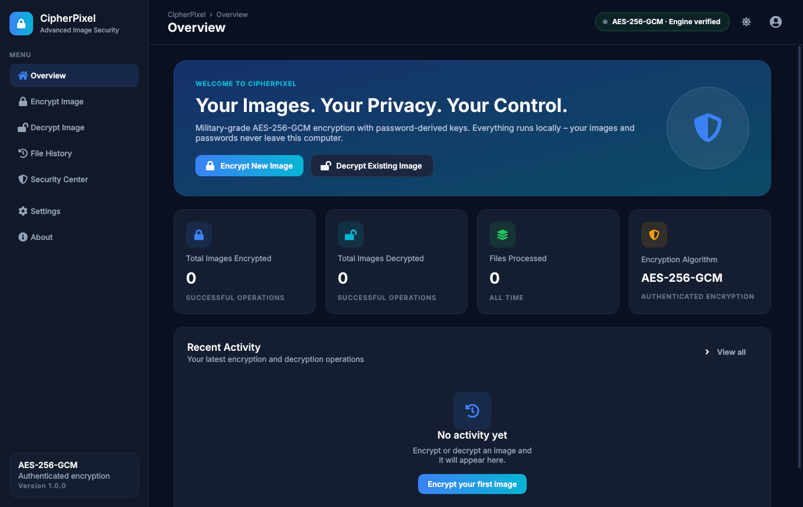
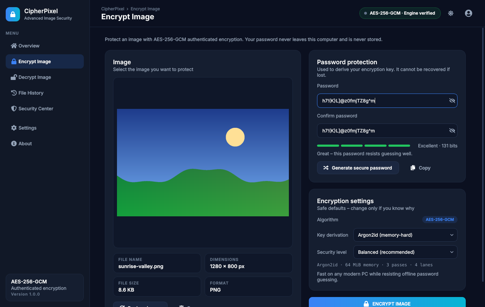
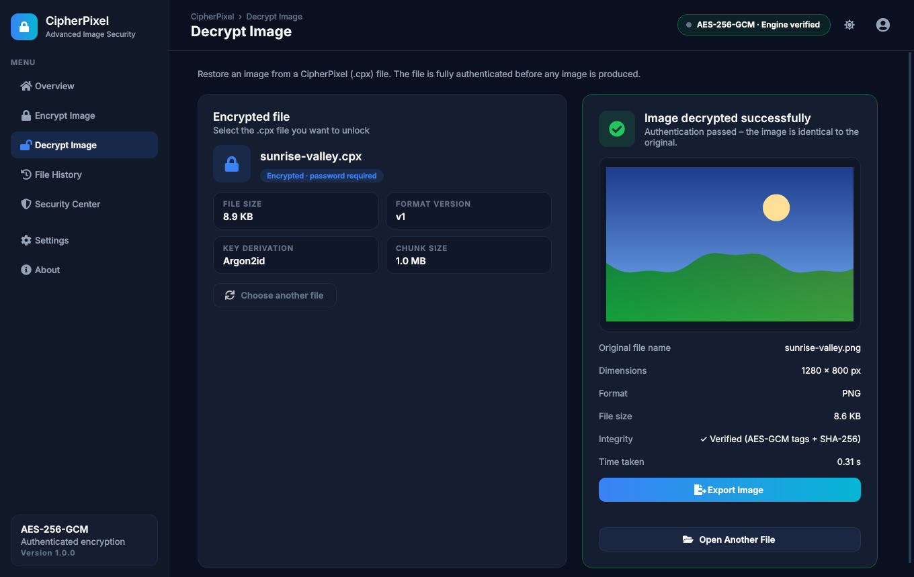

# CipherPixel – Advanced Image Security System

Desktop application that encrypts images into authenticated `.cpx` files and restores them
**byte-for-byte**, using standard cryptography (AES-256-GCM + Argon2id/PBKDF2) behind a modern
PySide6 interface. Everything runs locally; there is no network code.



| Encrypt | Decrypt |
|---|---|
|  |  |

More screenshots are in [`docs/screenshots/`](docs/screenshots): wrong-password error, history, security
center, settings, light theme and the compact (narrow window) layout.

---

## 1. Installation (Windows 10/11)

1. Install **Python 3.11 or newer** from <https://www.python.org/downloads/> and tick
   **"Add python.exe to PATH"** in the installer.
2. Open *PowerShell* in the project folder and run:

```powershell
py -3.11 -m venv .venv          # or: py -m venv .venv
.\.venv\Scripts\Activate.ps1
python -m pip install --upgrade pip
pip install -r requirements.txt
python main.py
```

If PowerShell refuses to run the activation script:
`Set-ExecutionPolicy -Scope CurrentUser RemoteSigned`, or use `.\.venv\Scripts\activate.bat` in *cmd*.

**macOS / Linux:** `python3 -m venv .venv && source .venv/bin/activate && pip install -r requirements.txt && python main.py`
(Linux may additionally need `libxcb-cursor0`, see Troubleshooting.)

### Run the tests

```powershell
pip install -r requirements-dev.txt
python -m pytest                 # full suite (crypto + security + GUI)
python -m pytest tests/test_encryption.py tests/test_decryption.py tests/test_security.py   # no GUI needed
```

GUI tests run headless; on Windows set nothing, on Linux CI use `QT_QPA_PLATFORM=offscreen`.

---

## 2. Using the app

| Page | What it does |
|---|---|
| **Overview** | Totals, quick actions, recent activity. |
| **Encrypt Image** | Drag-drop or browse (PNG/JPG/JPEG/BMP/TIFF) → preview and facts → password (strength meter, show/hide, generator, copy) → KDF settings → **ENCRYPT IMAGE** → progress (cancellable) → **Save Encrypted File**. |
| **Decrypt Image** | Drag-drop or browse a `.cpx` → password → **DECRYPT IMAGE** → preview, original size/format → **Export Image**. |
| **File History** | Search, filter (encrypt/decrypt), sort, delete selected, clear, export CSV. |
| **Security Center** | Active configuration, a **live self-test** of the real engine, and plain-language explanations. |
| **Settings** | Export folder, theme, password visibility, clipboard clearing, default KDF, history recording, restore defaults. |

Shortcuts: `Ctrl+1` … `Ctrl+7` switch pages. The top-bar pill shows the result of the start-up self-test.

**Important:** passwords cannot be recovered. Encrypting does **not** delete your original image.

---

## 3. Encryption architecture

```
password ──NFKC──► KDF(salt, params) ──► 256-bit key ─┐
                                                       ├─► AES-256-GCM, one call per 1 MiB chunk
random salt (128-bit) + random nonce prefix (64-bit) ──┘
```

### `.cpx` format v1 (`core/cpx_format.py`)

```
HEADER (48 B, plaintext, authenticated)   magic "CPXF" | version | kdf id | flags=0
                                          kdf p1,p2,p3 | chunk size | salt[16] | nonce prefix[8]
META   chunk : u32 length | AES-GCM( JSON: file name, format, size, dimensions, SHA-256 ) | 16-B tag
DATA   chunk : u32 length | AES-GCM( ≤ 1 MiB of image bytes ) | 16-B tag        (repeated)
FINAL  chunk : u32 length | AES-GCM( last bytes )               | 16-B tag
```

* **Real, standard primitives only.** AES-256-GCM from the `cryptography` library; Argon2id
  (`argon2-cffi`) or PBKDF2-HMAC-SHA256. Nothing custom, no XOR/pixel tricks.
* **Whole file is encrypted**, not decoded pixels – so JPEG compression, EXIF and ICC profiles are restored exactly.
* **Nonce uniqueness.** Key = KDF(password, *fresh random salt*) → unique per file. Per-chunk 96-bit
  nonce = *8 random bytes ‖ 32-bit counter*, so no (key, nonce) pair is ever reused. Counter overflow is refused.
* **Streaming & ordering.** Each chunk's AAD = *entire header ‖ chunk type ‖ chunk index*. Changing any
  header byte, reordering, duplicating, splicing from another file, removing or appending a chunk makes a tag fail.
  The last chunk is typed `FINAL`, so **truncation is detected** even at an exact chunk boundary.
  Memory use is bounded (~2 chunks) so very large images do not exhaust RAM.
* **Fail closed.** Decryption writes to a temp file and moves it into place only after every tag, the size and the
  SHA-256 verify. A wrong password or damaged file never produces an output file.
* **Parameter bounds.** KDF memory/time/lanes and chunk size read from a header are range-checked *before* any
  expensive work, so a hostile file can't demand gigabytes of RAM.
* **No oracle.** Wrong password and tampered header give the same message. Errors never include key material.
* **Privacy.** Logs hold operation names, exception class names and redacted paths only. History stores file name,
  type, size, time and status only; passwords/keys/pixels are never persisted. CSV export neutralises formula injection.

### KDF presets (Settings → Default encryption configuration)

| Level | Argon2id | PBKDF2-HMAC-SHA256 |
|---|---|---|
| Balanced (default) | 64 MiB · 3 passes · 4 lanes | 600,000 iterations |
| Strong | 256 MiB · 4 passes · 4 lanes | 1,200,000 |
| Maximum | 512 MiB · 5 passes · 4 lanes | 3,000,000 |

Balanced meets/exceeds current OWASP minimums. Parameters are stored in each file, so changing the default never breaks old files.

---

## 4. Project layout

```
main.py                    entry point
core/                      GUI-independent engine (fully unit-tested)
  encryption.py decryption.py   streaming encrypt / authenticated decrypt
  cpx_format.py                 header + chunk sealing
  key_manager.py                Argon2id / PBKDF2, presets, bounds
  file_handler.py               image validation, atomic writes, free-space checks, temp dir
  security_utils.py             strength meter, password generator, filename sanitising
  history.py  selftest.py  errors.py
ui/                        PySide6 interface (shell, 7 pages, components/, theme.py, workers.py)
utils/                     settings, logger, paths, validators
tests/                     pytest suite   tools/make_screenshots.py   docs/screenshots/
```

Background work uses `QThread` workers with throttled progress and cooperative cancellation; the UI thread never blocks.
The theme system (`ui/theme.py`) is a small built-in QSS generator with dark and light palettes, used instead of `qdarktheme`
to keep the look fully consistent and dependency-light. Inter is bundled in `assets/fonts` (SIL OFL).

---

## 5. Tests

176 automated tests, including (spec items in brackets):
round-trip of PNG/JPG/JPEG/BMP/TIFF with exact byte equality [1-3]; wrong passwords [4]; a bit-flip in every region of the file,
every chunk, header and tag, truncation at every boundary, appended/duplicated/reordered/removed/spliced chunks [5-6];
unsupported, disguised and truncated images [7]; empty files [8]; a ~13 MB multi-chunk image [9]; unique nonces and salts [10-11];
bad magic/version/flags/KDF/chunk-size headers and absurd length fields [12]; cancel leaves no files; history privacy and
SQL/LIKE safety; settings validation; and 24 end-to-end GUI tests that click the real buttons and run real worker threads.
Mutating the code (constant salt, nonce reuse, dropped AAD, no FINAL flag) makes the suite fail, confirming the tests bite.

---

## 6. Limitations (please read)

* **Not independently audited.** It uses well-reviewed primitives, but the file format and application are new code.
* **Passwords:** Python cannot reliably zero strings in memory. The UI clears fields after use, but a memory dump of a running process could expose them.
* **Temporary files:** the encrypted/decrypted result waits in a private temp folder until you save or quit, then is deleted. Deleting is not secure erasure on SSDs;
  use full-disk encryption (BitLocker/FileVault) for protection against forensic recovery.
* Strength estimation is a heuristic, not a guarantee. Use the generator or a long passphrase.
* Your original image is left untouched – delete it yourself after verifying the `.cpx`.
* GIF/WebP and animated formats are intentionally not supported.
* Screenshots were rendered headlessly on Linux; layout on Windows uses the same Qt code, but fonts/DPI scaling may differ slightly.

---

## 7. Troubleshooting

| Problem | Fix |
|---|---|
| `python` not recognised | Reinstall Python with *Add to PATH*, or use `py -3.11`. |
| `ModuleNotFoundError: PySide6` / other import errors | Activate the venv, then `pip install -r requirements.txt`. |
| Pip fails building a package | Upgrade pip (`python -m pip install --upgrade pip`) and use 64-bit Python 3.11–3.13. |
| Argon2id unavailable notice | `pip install argon2-cffi` (the app falls back to PBKDF2 until then). |
| Linux: *"Could not load the Qt platform plugin xcb"* | `sudo apt install libxcb-cursor0 libxkbcommon-x11-0 libegl1` |
| "Decryption failed. The password is incorrect, or the file has been modified." | Check the password (case, keyboard layout, trailing spaces; use *show password*). If it is correct, the file was altered – restore from a backup. |
| "Integrity check failed…" | The file is corrupted or truncated (partial download/copy). Re-copy it from the source. |
| "Not enough memory…" | Choose a lower security level; *Maximum* Argon2id needs ~0.5 GB RAM. Files already encrypted at that level need the same memory to open. |
| "Not enough free disk space" | Free space on the destination drive (output ≈ size of the image). |
| Blurry/small UI on a high-DPI display | Qt scales automatically; set Windows *Display scaling* to a standard value (100–200 %). |
| Something odd | Look at `data/logs/cipherpixel.log` (no passwords or image data are ever logged). Data falls back to `%APPDATA%\CipherPixel` if the project folder isn't writable. |

Regenerate screenshots: `python tools/make_screenshots.py`
# cipherpixel

# cipherpixel

